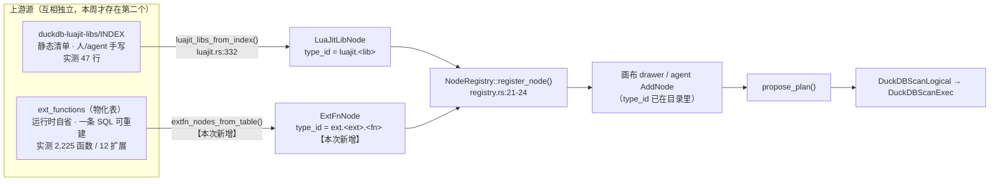
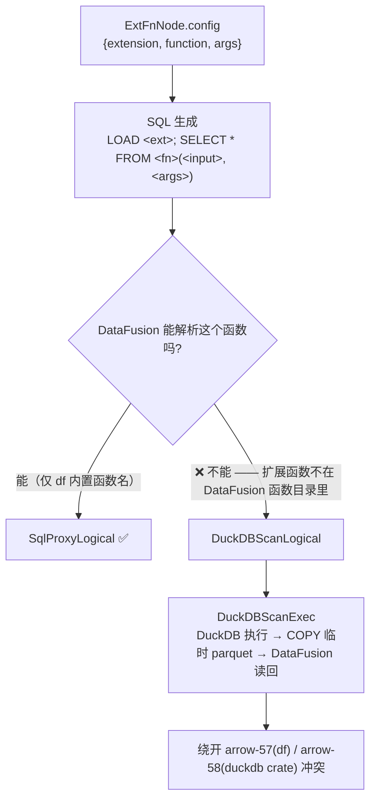

# Design: extfn-auto-nodes

> 状态：**待评审** ｜ 评审通过后才进 `tasks.md` + 写 Rust
> 所有结论均在**本机源码逐行核实**，行号可直接跳转；实测数字来自 2026-09-21 PoC。

---

## 1. 前置验证（已完成的证据）

### 1.1 上游数据源实测（DuckDB v2.0.0-alpha39998，本机）

| 项 | 实测值 | 证据 |
|---|---|---|
| 一条 SQL 建表产出 | **2,225 函数 / 12 扩展** | `/tmp/extfun/probe20.sql` → `poc20.duckdb` |
| `parameter_types` 填充率 | **98.1%**（2183/2225） | 同上 |
| `description` 填充率 | 76.6% **但 1705/1705 全来自 `core_functions`**；非 core 扩展一律 0% | 同上 |
| `has_side_effects=true` | 仅 **12** 条 | 同上 |
| ⚠️ `INSTALL` | **全部失败**（dev/alpha 构建 hash `5319116087` 官方不发布二进制） | 30 个扩展全 `HTTP Error` |

> ⚠️ **这条环境限制直接决定设计**：本机只能载 `~/.duckdb/extensions/<version>/linux_amd64/`
> 里**预置**的二进制（v2.0 目录 **8 个**：ducklake / excel / fts / httpfs / luajit /
> postgres_scanner / quack / sqlite_scanner）。**⇒ 不能指望启动时实时 LOAD 任意扩展。**

### 1.2 建表语句（PoC 已验证）

```sql
CREATE TABLE ext_functions AS
SELECT extension_name, function_name, function_type, parameters, parameter_types,
       return_type, description, examples, categories, has_side_effects, stability
FROM duckdb_functions()
WHERE extension_name IS NOT NULL AND extension_name <> '';
```

> ⚠️ **版本门槛**：`extension_name` 列 **v2.0 有、v1.5.4 无**（v1.5.4 的
> `duckdb_functions()` 没有该列）⇒ 建表脚本必须探测版本，无该列时退化为「装载差分」。

---

## 2. 蓝本逐行对照（DuckFlow → SwanFlow）

### 2.1 蓝本 A：`ExtensionCall`（`duckflow/src/Compiler/DuckDbCompiler.cs:1724-1754`）

蓝本逻辑（两个分支）：

```csharp
// 分支 1：显式 SQL 模板（KNIME ML 后处理用）
if (!string.IsNullOrWhiteSpace(sqlTemplate)) {
    sqlTemplate = sqlTemplate.Replace("{{input}}", input);   // 无输入 → "(SELECT 1)"
    return sqlTemplate;
}
// 分支 2：{extension, function, args}
var sql = string.IsNullOrEmpty(ext) ? "" : $"LOAD {ext}; ";
if (hasInput) sql += $"SELECT * FROM {func}({input}, {args})";   // 输入表当头参
else          sql += $"SELECT * FROM {func}({args})";
```

### 2.2 蓝本 B：`ExtListFuncs`（`DuckDbCompiler.cs:1756-1765`）

```csharp
var sql = !string.IsNullOrEmpty(ext) ? $"LOAD {ext}; " : "";
sql += $"SELECT function_name, function_type, parameter_types, return_type "
     + $"FROM duckdb_functions() WHERE function_name LIKE '{pattern}' ORDER BY function_name";
```

> ⚠️ **蓝本 B 有偏差，不能照搬**：它是**按函数名 `LIKE` pattern 过滤**，
> **完全没用 `extension_name`**。也就是说 DuckFlow 做不到「列出某个扩展导出的全部函数」，
> 只能「列出名字像 X 的函数」。
> ⇒ 我们移植的是**语义**（列出扩展的函数签名），实现要**升级**为 `extension_name` 归因
> —— 这正是本轮 PoC 证明 v2.0 能做到的那一步。**照搬 = 丢掉这次升级。**

### 2.3 对照总表

| 维度 | DuckFlow 蓝本 | SwanFlow 目标 | 差异处理 |
|---|---|---|---|
| 语言/范式 | C# 字符串拼 SQL | Rust `NodeBehavior` trait + typed ports + `config_schema` | 不搬字符串模板 |
| 算子参数 | `config{extension,function,args}`，`args` 是**裸 SQL 文本** | 同上结构，但 `args` 走 `struct_literal()` 转 DuckDB struct 字面量 | 复用 luajit 的 `struct_literal` |
| 输入注入 | `{{input}}` 模板 / `GetInputCte` | typed input ports（`Vec<LogicalPlan>`） | **结构性更好，不用模板** |
| 函数清单源 | `duckdb_functions()` + `LIKE` | `ext_functions` **物化表** + `extension_name` 归因 | 升级（见 §1.1） |
| 注册 | 手写 C# 插件 DLL（`INodePlugin`） | `NodeRegistry::register_node()` 自动注册 | 升级为自动 |
| 端口 | 无端口声明（`NodeSchema` 里另表） | `PortSpec{id,name,description}` 内嵌 `NodeSpec` | 按 `function_type` **推导** |

---

## 3. 架构图：两个源、一个注册表（本设计的核心）



**这张图就是本 change 的论证**：不是新建一条链，而是**给已有的自动注册机制换/加一个源**。
`registry.rs:104-117` 那个 `if let Some(index_path) = default_luajit_libs_index()` 块
旁边，再加一个并列的块即可。

---

## 4. 执行路径：为什么必须走 `DuckDBScanLogical`（最大的技术陷阱）



**依据（skill 已记录的实测结论，本次沿用不重调研）**：
`nodes/luajit.rs` 当初就是因为 `luajit_table` 是 DuckDB 扩展函数、DataFusion SQL 引擎不认，
才把 `propose_plan` 从 `SqlProxyLogical` 改为产出 `DuckDBScanLogical`。
**任意扩展函数与 `luajit_table` 完全同类** ⇒ 同一条路。
另：`DuckDBScanExec` 的扩展加载已支持**绝对路径**（含 `/` 或 `.duckdb_extension` 结尾 →
直接 `LOAD '<path>'`，裸名才走 `INSTALL`+`LOAD`）—— 这条正好吃到 §1.1 的环境限制。

---

## 5. 决策（已定 —— 2026-09-21 用户授权「你做决定，拿不准就头脑风暴」）

### 决策 1：`type_id = ext.<extension>.<function>` ✅

`register_node` 是 `HashMap::insert`（`registry.rs:21-24`）⇒ **同名静默覆盖**。实测
`duckdb_functions()` 存在同名重复行（overload），跨扩展同名完全可能。带扩展名**根除冲突**，
且与蓝本 `extension_call` 的 config `{extension, function}` 天然对齐。
副产品：同名 overload **自动合并为一个节点**（DuckDB 调用期自重载解析）—— 正是画布该有的粒度。

### 决策 2：读物化表，独立文件 `<cache_dir>/ext_functions.duckdb` ✅

- 路径优先 `SWANFLOW_EXT_FUNCTIONS_DB`，默认 `target/swanflow_cache/ext_functions.duckdb`
  （与 `main.rs:600-601` 的 `target/swanflow_cache/metadata.duckdb` 同目录；**env-override
  是本仓既定模式** —— `SWANFLOW_LUAJIT_LIBS_INDEX` / `SWANFLOW_LUAJIT_LIBS_DIR` /
  `SWANFLOW_DUCKDB_EXTENSIONS` / `SWANFLOW_LUAJIT_EXT` 全是）
- **不并进 `metadata.duckdb`**：该库有已知并发写风险（并行测试共享 → DuckDB C++ abort，
  见 skill 记录），且生命周期由 engine 接管；独立文件解耦且安全
- **缺库/缺表 → 静默不注册**，与 luajit 的失败语义一致
  （`registry.rs:106` 注释原文 *"Missing INDEX is fine — just the generic shell node remains"*）

### 决策 3：三档过滤 + `enabled` 列人工策展 ✅（本设计最重要的自律）

实测（`poc20.duckdb`，v2.0）给出了一个**意外干净的过滤器**：

| function_type | core_functions | 非 core |
|---|---:|---:|
| scalar | 544 | 405 |
| **aggregate** | **1165** | **0** |
| **table** | **0** | **93** |
| macro | 0 | 11 |
| pragma | 0 | 5 |
| table_macro | 0 | 2 |

> ⭐ **`function_type='table'` 零误伤**：core 的 table 函数是 **0 个** ⇒ 该条件天然等价于
> 「扩展提供的真算子（scanner / generator）」。而 `aggregate` 1165 个**全在 core**
> ⇒ 排除 `core_functions` 顺带清掉最大一块。

- **档 1（默认注册）**：`function_type='table'` 且 `extension_name<>'core_functions'`
  ⇒ 本机实测 **66 个节点**（ducklake 20 / quack 10 / json 10 / postgres_scanner 8 /
  parquet 8 / autocomplete 3 / sqlite_scanner 3 / icu 2 / shell 1 / excel 1）
- **档 2（默认不注册，`enabled=TRUE` 才注册）**：`function_type IN ('scalar','aggregate')`
  且非 core ⇒ 本机 405 个候选，**人工策展**（与 skills-db 的
  *"curation decisions belong to the human"* 同构）
- **硬排除**：`core_functions` / `internal=true` / `function_type IN ('pragma','macro','table_macro')`

> **量化对比：不做过滤 = 2,225 个节点（画布废掉）；做过滤 = 66 个。**
> 这就是把「风险自律」从口号变成数字的地方。

### 决策 4：`core.flow.extension` 的 12 项白名单**本次不动** ✅

`boundary.rs:122-135` 的白名单是 `validate` 里的**准入控制**（放行任意扩展 = 放行任意代码），
改它属**安全相关改动**，应独立 change 评审。
代价记入 §6 第 8 条：存量 loader 用不了 ducklake/quack/postgres_scanner，而新算子路径能用
—— **这个不一致是刻意保留的**，新路径的准入控制由「物化表 + 三档过滤 + `enabled` 列」承担。

### 决策 5：`TypedNodeBehavior` 不拆分，单 struct 1/1 ✅

原先担心的 const 问题**经核实不存在**：`LuaJitLibNode` 自己就是
`INPUT_COUNT=1, OUTPUT_COUNT=1`（`luajit.rs:321-324`），而它的 table 模式**实际 0 输入**
—— 说明这些 const 是**宽松声明而非强制校验**（`FilterNode`/`SqlNode`/`LuaJitNode` 全是 1/1）。
⇒ **照抄先例：单个 `ExtFnNode`，1/1**；形态差异由 `config_schema` 的 `mode` 枚举
+ `propose_plan` 分支承担。

### 决策 6：`struct_literal` 提升为 `pub(crate)` ✅

`luajit.rs:207` 现为私有 `fn struct_literal`。`extfn.rs` 需同款 JSON→DuckDB struct 字面量
转换（处理 `args`）。**最小改动 = 加 `pub(crate)`**，避免复制实现。
（`nodes/luajit.rs` **不在**他人未提交 WIP 名单内 ⇒ 可安全改动。）

---

## 6. 已知陷阱（写入实现前的自查清单）

1. **`propose_plan` 必须出 `DuckDBScanLogical`**（§4）—— 走 `SqlProxyLogical` 会在
   planning 期报「函数不存在」。
2. **`register_node` 是同名静默覆盖**（决策 1 的依据）。
3. **`NodeSpec` 没有 `category` 字段**（`nodes/mod.rs:40-47`）—— DuckFlow 有 category，
   不能照搬；分类信息只能塞进 `type_id` 前缀或 `display_name`。
4. ✅ **已解决（决策 5）**：~~`TypedNodeBehavior` 的 `INPUT_COUNT`/`OUTPUT_COUNT` 是 const，
   不同形态端口数不同~~ —— 核实后**该问题不存在**：`LuaJitLibNode` 自己就是
   `INPUT_COUNT=1, OUTPUT_COUNT=1`（`luajit.rs:321-324`）而它的 table 模式**实际 0 输入**
   ⇒ const 是**宽松声明而非强制校验**。照抄先例：单 struct，1/1。
5. **扩展可载率 ≠ 100%**（§1.1 `INSTALL` 全失败）—— e2e 测试必须挑本机**确实可载**的
   扩展（ducklake / excel / fts / httpfs / quack / sqlite_scanner / postgres_scanner），
   并像 luajit 的集成测试那样 **env-gated**（未设即 skip，CI 不炸）。
6. **`description` 多数为空**（实测非 core 扩展 0%）—— 节点的 `description` 字段
   只能放「签名」，**不要写「自动生成即可用」这类承诺**（与 wiki 页判词一致）。
7. **swanflow 工作树有他人未提交 WIP**（`crates/swanflow/Cargo.toml`、`core/datasource/excel.rs`、
   `core/engine/planner.rs`、`nodes/transform.rs`）—— **实现时不触碰这四个文件**。
8. **已知不一致（刻意保留，见决策 4）**：`core.flow.extension` 仍受 12 项硬编码白名单限制
   （`boundary.rs:122-135`），故 ducklake / quack / postgres_scanner / sqlite_scanner 等
   **在 loader 节点里用不了、在新算子路径里能用**。这是「安全改动独立评审」的代价，**不是遗漏**。

---

## 7. 构建与验证的现实约束（必须先说清）

| 约束 | 现状 | 应对 |
|---|---|---|
| WSL `cargo` TLS 全坏 | 无法联网拉 crates | `--offline` + curl 补缓存（skill `cargo-offline-deps`） |
| 长构建会被审批门拦 | 用户不在线时前台 >60s 与 `background=true` 均 BLOCKED | 先交不依赖构建的产物（本设计件 + 单测代码），构建等「继续」 |
| Mac 远程编译 | `sa@10.10.10.100`（IP 常变）；仓库 `~/ws/swanflow` 可能落后 | 用 worktree 隔离验证，`CARGO_TARGET_DIR` 复用 |

> ⚠️ 单用户本地仓库、无协作者 ⇒ 按仓库既定纪律**不开功能分支、直接落 main**。
